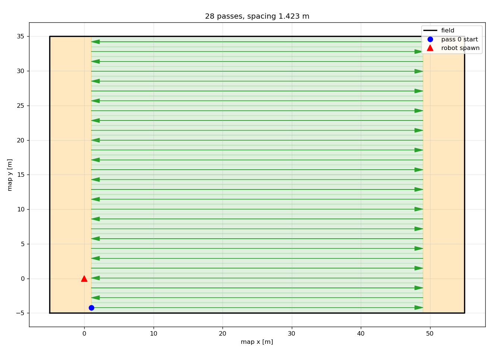
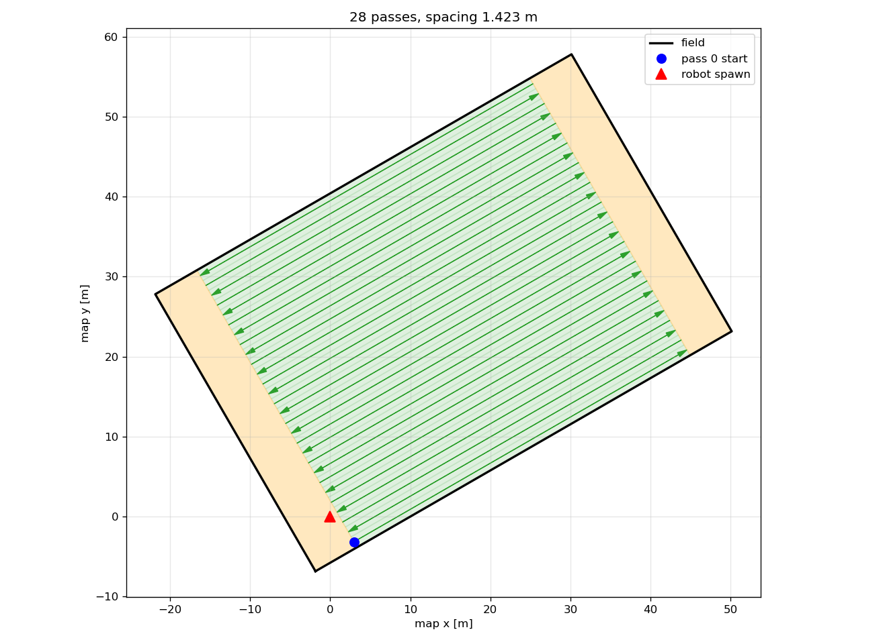
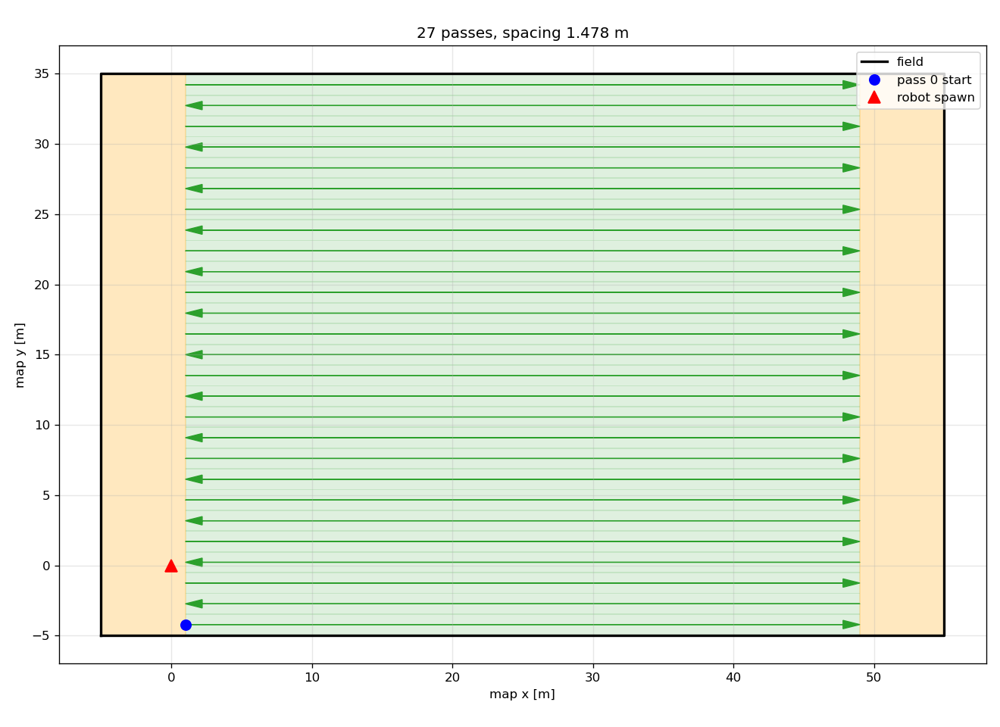

# Agrios Robot Workspace (`agrios_ws`)

ROS 2 workspace for the simulation, state estimation, navigation, and coverage planning of **Agrios**, an autonomous GPS-guided agricultural robot for Indian row-crop farming.

This README describes the current state of the workspace: what each package does, how the pieces connect, how to run it, and what is known to break.

---

## 1. Status

| Area | State |
|---|---|
| Robot model (URDF/Xacro) | Working. Front-steer Ackermann, 4WD. Coordinated 4WS not yet implemented |
| Simulation | Working on Gazebo Harmonic, RTF 1.0 at 10 ms physics step |
| Sensors (LiDAR, IMU, NavSat, ground truth) | Working |
| RTK GPS simulation | Working: position noise + synthetic dual-antenna heading |
| Localization (dual EKF) | Working, `map -> odom -> base_footprint` resolves cleanly |
| Navigation (Nav2) | Working end to end: goals complete |
| Coverage planning | Pass layout + coverage check done (`agrios_coverage`). Turns and execution not yet implemented |
| Field boundary / keepout | Not implemented |
| Tests | None beyond ament lint boilerplate |

---

## 2. Stack

| Component | Version |
|---|---|
| OS | Ubuntu 24.04 (Noble) |
| ROS 2 | Jazzy |
| Simulator | Gazebo Harmonic (gz-sim 8), installed via `ros-jazzy-ros-gz` vendor packages under `/opt/ros/jazzy/opt/` |
| Localization | `robot_localization` |
| Navigation | Nav2 (Smac Hybrid-A*, Regulated Pure Pursuit) |
| Behavior trees | BehaviorTree.CPP v4 |

**Machines**

- **PC (simulation):** x86_64, Ubuntu 24.04. Runs Gazebo and the full stack.
- **Jetson Orin NX (deployment target):** JetPack 7.2, Jazzy. Can run the stack, but the full simulation saturates it. Use it for hardware bring-up, not for simulation.

The workspace was ported from Humble / Gazebo Fortress. The last Humble state is tagged `humble-nav-working`.

---

## 3. Repository layout

```
agrios_ws/
├── README.md
├── images/                      README plots
└── src/
    ├── agrios_description/      ament_cmake  - robot model, world, simulation launch
    │   ├── urdf/agrios.urdf.xacro
    │   ├── worlds/agrios_empty.sdf
    │   ├── launch/display.launch.py
    │   ├── launch/sim.launch.py
    │   ├── rviz/agrios.rviz
    │   └── meshes/              (empty, primitives only)
    ├── agrios_control/          ament_python - sensor degradation nodes
    │   └── agrios_control/
    │       ├── rtk_sim.py
    │       └── odom_cov_relay.py
    ├── agrios_bringup/          ament_cmake  - configs and launch orchestration
    │   ├── config/
    │   │   ├── ekf_local.yaml
    │   │   ├── ekf_global.yaml
    │   │   ├── navsat_transform.yaml
    │   │   └── nav2_params.yaml
    │   ├── behavior_trees/navigate_no_spin.xml
    │   └── launch/
    │       ├── localization.launch.py
    │       ├── nav2.launch.py
    │       └── bringup.launch.py
    └── agrios_coverage/         ament_python - coverage path planning
        └── agrios_coverage/field_layout.py
```

`agrios_description` and `agrios_bringup` are `ament_cmake` even though they contain no C++: they only install data files, and `install(DIRECTORY ...)` is simpler than `ament_python` data_files globbing.

---

## 4. Packages

### 4.1 `agrios_description` - robot model and simulation

#### `urdf/agrios.urdf.xacro`

**Geometry**

| Property | Value | Source |
|---|---|---|
| Track width | 1.35 m | spec (locked by row geometry) |
| Wheel radius | 0.30 m | spec |
| Wheel width | 0.11 m | spec |
| Ground clearance | 0.45 m | spec |
| Wheelbase | 1.50 m | **assumed - verify against CAD** |
| Steering limit | ±35° | **assumed - verify against CAD** |
| Chassis | 1.8 × 1.1 × 0.3 m | derived |
| Mass | 900 kg total | placeholder |

**Kinematic tree.** Each corner is `base_link -> {fl,fr,rl,rr}_steer_link -> {fl,fr,rl,rr}_wheel_link`. The intermediate steer link is required for any steering mode.

`base_link` sits at axle height (`base_footprint` + 0.30 m), so all four steer joint origins have `z = 0`.

**Steering lock.** The `lock_steering` argument makes the steer joints `fixed` (`true`) or `revolute` (`false`). The comparison is a string compare (`lock_steer == 'true'`) on purpose: `$(arg)` returns a string, and `"false"` is truthy in Python.

**Drive plugin.** `gz::sim::systems::AckermannSteering` drives all four wheels and steers the front two. Requires `lock_steering:=false`. Minimum turning radius:

```
R = L / tan(δ) = 1.50 / tan(35°) = 2.14 m
```

Skid steer (DiffDrive) was used earlier and abandoned in simulation: wheel-slip yaw corrupted `ekf_local`, producing a 96.8° `map -> odom` error and goals that never completed. Ackermann brought it to 0.3°. A switchable drive mode for comparing the two is planned.

**Sensors**

| Sensor | Type | Link | Topic | Rate |
|---|---|---|---|---|
| LiDAR | `gpu_lidar`, 2D, 360 samples, 40 m | `lidar_link` (z = 2.0 m) | `/scan` | 5 Hz |
| IMU | `imu` | `imu_link` | `/imu` | 100 Hz |
| GNSS | `navsat` | `gps_link` (z = 2.05 m) | `/navsat` | 10 Hz |
| Ground truth | `OdometryPublisher` | `base_footprint` | `/ground_truth` | 50 Hz |

Every sensor sets `<gz_frame_id>`. Without it Gazebo stamps scoped frames like `agrios/base_footprint/lidar`, which do not exist in TF, and RViz and the costmaps silently drop the messages.

**System plugins required on the model**

- `gz::sim::systems::Sensors` (`render_engine ogre2`) - without it sensors never activate, with no error
- `gz::sim::systems::Imu`
- `gz::sim::systems::NavSat`
- `gz::sim::systems::JointStatePublisher`

**TF suppression.** `AckermannSteering` and `OdometryPublisher` both set `<tf_topic>/gz_tf_unused</tf_topic>`. `ekf_local` owns `odom -> base_footprint`; two publishers on one TF edge cause jitter that looks like an EKF tuning problem.

#### `worlds/agrios_empty.sdf`

- **Spherical coordinates:** 30.9° N, 75.85° E, 245 m, ENU. Required for NavSat. ENU is required by `navsat_transform`.
- **World name must stay `empty`.**
- **Physics step 0.01 s (100 Hz).** At 0.001 s, `/clock` ran at ~500 Hz, dropped messages, and RTF fell to 0.64, which broke TF timing across the stack. 100 Hz is ample for a 1.5 m/s ground vehicle.
- World plugins: Physics, UserCommands, SceneBroadcaster, Contact.

#### `launch/sim.launch.py`

- Gazebo headless: `gz sim -r -s -v 4 agrios_empty.sdf`
- `robot_state_publisher` with `use_sim_time: true`
- Spawn via `ros_gz_sim create` from `/robot_description`
- `ros_gz_bridge` for `/clock`, `/cmd_vel`, `/odom`, `/tf`, `/imu`, `/ground_truth`, `/navsat`, `/scan`, `/joint_states`
- Sets `__EGL_VENDOR_LIBRARY_FILENAMES` on the Gazebo process. Needed on Jetson (Tegra EGL); not needed on the PC.

Bridge syntax: `topic@ros_type[gz_type` is Gazebo -> ROS, `]` is ROS -> Gazebo.

`/clock` is mandatory. Without it every `use_sim_time` node stays at t = 0.

#### `launch/display.launch.py`

URDF check without physics: `robot_state_publisher`, `joint_state_publisher_gui`, RViz. Fixed Frame `base_footprint`.

---

### 4.2 `agrios_control` - sensor degradation

Gazebo produces perfect data with zero covariance. These nodes make it hardware-like so the localization stack is tuned against something realistic.

#### `rtk_sim.py`

Models an ArduSimple simpleRTK2B Heading Kit (2× ZED-F9P).

- **Inputs:** `/navsat`, `/ground_truth`
- **Outputs:** `/rtk/fix` (`NavSatFix`), `/rtk/heading` (`Imu`), 8 Hz

**Position:** Gaussian noise added in metres, converted to degrees:

```python
dlat = random.gauss(0.0, sigma_h) / 111320.0
dlon = random.gauss(0.0, sigma_h) / (111320.0 * math.cos(math.radians(lat0)))
```

Longitude is scaled by `cos(latitude)` because meridians converge. Covariance is set to σ² on the diagonal, status `STATUS_GBAS_FIX` (closest standard enum to RTK fixed).

**Heading:** true yaw from ground truth plus Gaussian noise, published as an `Imu` orientation. Roll and pitch covariance are `1e6` (a single baseline cannot measure them); unused velocity and acceleration covariances are `-1` (ROS convention for "not populated"). No drift term: moving-baseline heading is absolute.

| Parameter | Default |
|---|---|
| `pos_sigma_h` | 0.015 m |
| `pos_sigma_v` | 0.030 m |
| `heading_sigma_deg` | 0.20° |
| `rate_hz` | 8.0 |

Not modelled: RTK fixed/float transitions, correction dropout, multipath, latency.

#### `odom_cov_relay.py`

`/odom` -> `/odom_cov`, injecting twist covariance (vx 0.05, vy 0.05, vyaw 0.02). Zero covariance makes `robot_localization` treat a measurement as perfect and saturates the Kalman gain.

---

### 4.3 `agrios_bringup` - localization and navigation

#### Localization (`localization.launch.py`)

Starts `odom_cov_relay`, `rtk_sim`, `ekf_local`, `ekf_global`, `navsat_transform`.

**Why two EKFs.** The controller needs a smooth pose; the planner needs an accurate one. `ekf_local` fuses relative sensors only, so it never jumps but drifts. `ekf_global` adds GPS, so it is accurate but jumps when GPS corrects drift. The jump is absorbed into `map -> odom`, so the controller (working in `odom`) never sees it.

```
map  -> odom            ekf_global
odom -> base_footprint  ekf_local
```

**`ekf_local.yaml`**

- `world_frame: odom`, 50 Hz, `two_d_mode: true`
- Wheel odometry: velocities only, never absolute pose
- `vy` fused as 0 (nonholonomic constraint). Without it lateral covariance diverged to ~3e7
- IMU: yaw rate only. Linear acceleration is **not** fused (it caused 39% position overshoot via double integration)
- No rejection thresholds: once real covariance is injected, a tight Mahalanobis threshold rejects every update

**`ekf_global.yaml`**

- Same as local, plus:
- `world_frame: map`
- `/odometry/gps`: absolute x, y only (`odom1_differential: false`)
- `/rtk/heading`: absolute yaw
- **30 Hz, queue sizes 5.** At 50 Hz it stalled for up to 330 ms, freezing `map -> odom`

**`navsat_transform.yaml`**

- `use_odometry_yaw: false` - heading comes from `/rtk/heading`
- `magnetic_declination_radians: 0.0` - correct, RTK heading is true north
- `wait_for_datum: true`, `datum: [30.9, 75.85, 0.0]` - pins the `map` origin so it does not depend on where the robot was when the node started
- Remappings: `imu -> /rtk/heading`, `gps/fix -> /rtk/fix`, `odometry/filtered -> /odometry/global`

`navsat_transform` and `ekf_global` depend on each other (circular). A few seconds of warnings at startup are expected.

#### Navigation (`nav2.launch.py`)

Nodes: `controller_server`, `planner_server`, `behavior_server`, `bt_navigator`, `lifecycle_manager`. Lifecycle order matters; `bt_navigator` is last.

**Costmaps**

| | Local | Global |
|---|---|---|
| Frame | `odom` | `map` |
| Size | 12 × 12 m @ 0.05 m | 50 × 50 m @ 0.1 m |
| Rolling window | yes | yes (placeholder until a field map exists) |
| Layers | obstacle, inflation | obstacle, inflation |

- Footprint: real rectangle `[[0.9, 0.75], [0.9, -0.75], [-0.9, -0.75], [-0.9, 0.75]]`
- `inflation_radius: 1.5` (must exceed circumscribed radius 1.17 m), `cost_scaling_factor: 3.0`
- `min_obstacle_height: 0.3` filters ground returns from the mast-mounted scan
- `transform_tolerance: 1.0` on both costmaps
- `always_send_full_costmap: true`

LiDAR is used **only** by the costmap obstacle layer. It is not used for localization, and there is no SLAM.

**Planner: Smac Hybrid-A\***

- Searches `(x, y, θ)` with motion primitives at the minimum turning radius, so every path is drivable
- `motion_model_for_search: REEDS_SHEPP` (reverse allowed)
- Plugin names use `::` in Jazzy (`nav2_smac_planner::SmacPlannerHybrid`), not `/`

**Controller: Regulated Pure Pursuit**

- `use_rotate_to_heading: false` - the vehicle cannot rotate in place
- Goal checker: `xy_goal_tolerance: 0.5`, heading check effectively disabled

**Behavior tree: `behavior_trees/navigate_no_spin.xml`**

Nav2's default trees call `<Spin/>`, which this vehicle cannot do. Recoveries are clear costmaps, back up 1.0 m, wait. BT.CPP v4 format (`BTCPP_format="4"`, `Sequence` instead of `SequenceStar`).

#### `bringup.launch.py`

One-command startup: sim, then localization (15 s), Nav2 (20 s), RViz (30 s). Timers are approximate. RViz must start after localization, otherwise it buffers messages for frames that do not exist yet.

---

### 4.4 `agrios_coverage` - coverage path planning

`field_layout.py` is plain Python (numpy, shapely, matplotlib), no ROS dependency yet. Given four hardcoded field corners, it computes a boustrophedon pass layout and verifies coverage geometrically.

**Pipeline**

1. **Polygon:** validate corners, force counter-clockwise (shoelace sign), reject self-intersecting or degenerate polygons.
2. **Field frame:** pass direction `u` = longest edge, `n` = `u` rotated +90° (into the field for a CCW polygon). Ties between equal edges are broken by the start corner nearest the robot. All later math is done in this frame, so a rotated field is the same problem.
3. **Passes:** coverage width `W = 1.575 m` (7 rows × 22.5 cm), effective width `W_eff = W - overlap`.

   ```
   N = ceil((w - W) / W_eff) + 1
   spacing = (w - W) / (N - 1)
   ```

   Passes are spaced evenly (not clamped at the last edge), so every transition has the same lateral offset. Directions alternate. Each pass runs from `x = H` to `x = length - H`, leaving headlands for turning.
4. **Transitions:** turn side alternates (left after a `+u` pass), plus a `needs_reverse` flag when the offset is below `2R`.
5. **Coverage check:** union of coverage strips vs the interior region; reports interior coverage %, area outside the field, overlap area, headland area.

**Run**

```bash
sudo apt install -y python3-numpy python3-shapely python3-matplotlib
cd ~/agrios_ws/src/agrios_coverage/agrios_coverage
python3 field_layout.py
```

Writes `layout_*.png` plots next to the script (gitignored). The copies shown below are committed under `images/`.

**Results for a 60 × 40 m field, H = 6 m**

| Overlap | Passes | Spacing | Overlap area | Interior covered |
|---|---|---|---|---|
| 0.10 m | 28 | 1.423 m | 196.8 m² | 100% |
| 0.097 m | 27 | 1.478 m | 121.2 m² | 100% |

- **3 mm of overlap costs one full pass and one turn.** Overlap should come from measured tracking error, not a round number.
- **Every transition needs a reversing turn.** Pass offset (~1.42 m) is far below `2R` (4.28 m Ackermann, 2.14 m coordinated 4WS), so no forward U-turn reaches the adjacent pass.
- **Headlands are 480 m², 20% of the field,** and not covered by the passes. `H = 6 m` is a placeholder until turn geometry gives the real minimum.

**Plots**

Orange = headlands, green = pass coverage strips, blue dot = start of pass 0, red triangle = robot spawn.

Axis-aligned field, overlap 0.10 m, 28 passes:



Same field rotated 30°. Identical layout in the field frame, which confirms the frame transform:



Overlap 0.097 m, 27 passes:



---

## 5. Running

### Build

```bash
cd ~/agrios_ws
rosdep install --from-paths src --ignore-src -r -y
colcon build --symlink-install
source install/setup.bash
```

`--symlink-install` means Xacro, SDF, and YAML edits take effect without rebuilding. New launch files and `CMakeLists.txt` changes still need a rebuild.

### Full stack

```bash
ros2 launch agrios_bringup bringup.launch.py
```

### Individual layers (easier to debug)

```bash
ros2 launch agrios_description sim.launch.py lock_steering:=false
ros2 launch agrios_bringup localization.launch.py
ros2 launch agrios_bringup nav2.launch.py
ros2 run rviz2 rviz2 -d src/agrios_description/rviz/agrios.rviz --ros-args -p use_sim_time:=true
gz sim -g    # Gazebo GUI client, connects to the headless server
```

Start each layer after the previous one is up. Nav2's planner takes ~25 s to configure (Smac builds a heuristic lookup table).

### RViz

- **Fixed Frame `odom`.** In `map` the robot visibly twitches at 8 Hz: that is the simulated RTK noise being corrected, not a bug.
- Costmap Map displays need **Durability Policy: Transient Local**, otherwise they show nothing.
- `RobotModel` reads `/robot_description` via its Description Topic property; the topic shows as "unvisualizable" in the topic browser.

### Send a goal

```bash
ros2 action send_goal /navigate_to_pose nav2_msgs/action/NavigateToPose \
"{pose: {header: {frame_id: map, stamp: {sec: 0, nanosec: 0}}, pose: {position: {x: 5.0, y: 0.0, z: 0.0}, orientation: {w: 1.0}}}}"
```

A zero stamp means "use the latest transform".

### Verify

```bash
gz topic -e -t /world/empty/stats -n 1      # real_time_factor ~1.0
ros2 topic hz /scan                         # ~5 Hz
ros2 topic hz /imu                          # ~100 Hz
ros2 topic echo /navsat --once              # 30.9, 75.85
ros2 run tf2_ros tf2_echo map odom          # small translation and yaw
ros2 run tf2_tools view_frames              # map -> odom -> base_footprint
```

---

## 6. Things that are easy to break

- **Gazebo namespace.** Harmonic uses `gz-sim-*-system` and `gz::sim::systems::`. Fortress-style `ignition-*` names fail silently: the plugin just does not load.
- **`<gz_frame_id>`** on every sensor, or the messages are dropped for an unknown frame.
- **Sensors system plugin** must be declared on the model.
- **`<tf_topic>/gz_tf_unused</tf_topic>`** on the drive and odometry plugins.
- **`world_frame`**: `odom` in `ekf_local`, `map` in `ekf_global`. Swapping them produces a plausible-looking but wrong TF tree.
- **ROS 2 YAML float arrays:** every zero must be `0.0`. A bare `0` fails to parse.
- **Nav2 plugin names** use `::` in Jazzy.
- **BT XML** must be `BTCPP_format="4"`.
- **Physics step.** 0.001 s drops RTF and floods `/clock`; symptoms are RViz jitter and "timestamp earlier than transform cache" in the costmaps.
- **Headings.** `±180°` is the same heading. Always compare wrapped differences, never raw angles.
- **Restart all or none.** Restarting localization while Gazebo keeps running gives a stale pose and offset frames.

---

## 7. Known issues

- Wheelbase (1.5 m) and steering limit (35°) are assumptions; both set the minimum turning radius used by the planner.
- Global costmap is a rolling window with no persistent field map.
- `obstacle_layer` will not see bunds: the scan plane is at z = 2.0 m.
- No `twist_mux`: teleop and Nav2 both publish `/cmd_vel`.
- No safety monitor, no `/cmd_vel` watchdog.
- No unit tests.

---

## 8. Next steps

1. **3-point turn geometry** (`agrios_coverage`): Reeds-Shepp turns between passes, swept-footprint check against the field polygon, find the minimum headland for R = 2.14 m and R = 1.07 m.
2. **Coverage grid node:** score actual coverage from `/ground_truth`.
3. **Turn primitive:** execute one 3-point turn in simulation, closed loop on RTK heading.
4. **Coverage executor:** straight passes via Nav2 `FollowPath`, turns via the primitive.
5. **Field boundary:** keepout mask from the field polygon, remove `obstacle_layer` (Phase 1 has no LiDAR), independent geofence node.
6. **Drive mode comparison:** skid steer vs Ackermann vs coordinated 4WS on minimum headland, coverage time, and localization drift.
